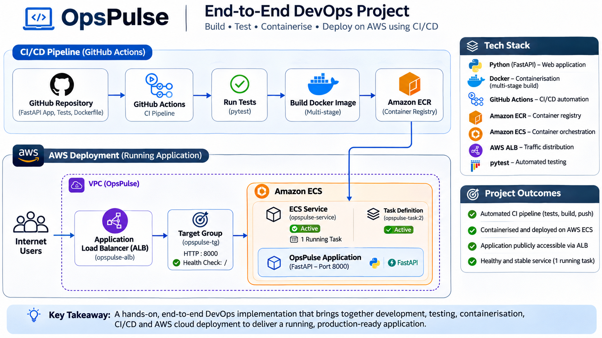
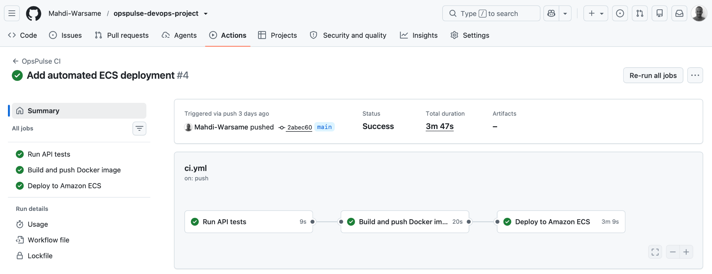
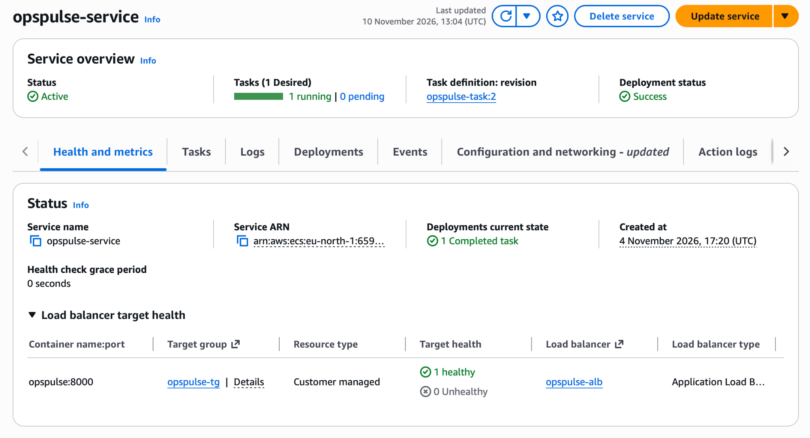
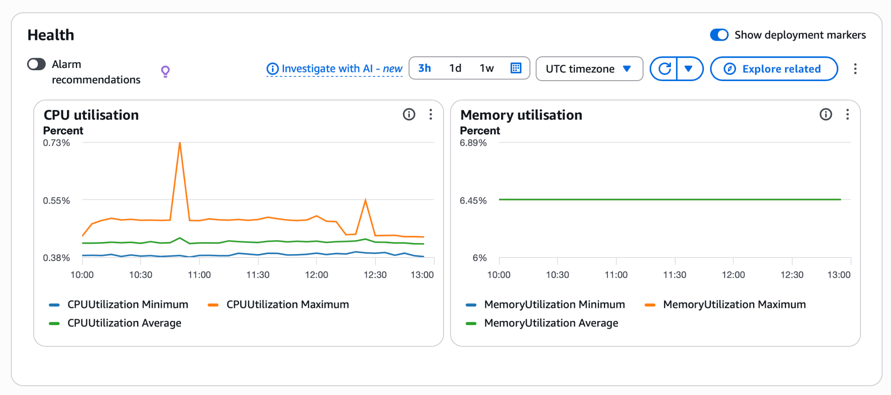

# OpsPulse — End-to-End DevOps Project

## Architecture



OpsPulse is a small **FastAPI-based DevOps health dashboard API** used to demonstrate an end-to-end delivery workflow: automated testing, multi-stage Docker image creation, publishing to Amazon ECR, and automated deployment to Amazon ECS.

The project focuses on connecting application development, testing, containerisation and cloud deployment into one repeatable CI/CD process.


### Delivery flow

1. A change is pushed to the `main` branch.
2. GitHub Actions runs the API test suite with `pytest`.
3. The workflow builds a multi-stage Docker image.
4. The image is tagged with the commit SHA and `latest`, then pushed to Amazon ECR.
5. The workflow retrieves the current ECS task definition, renders it with the new image, and deploys it to the ECS service.
6. The deployment job waits for ECS service stability.

Pull requests targeting `main` run the test job. Image publishing and ECS deployment are restricted to pushes to `main`.

## Technology stack

| Technology | Role in this project |
| --- | --- |
| Python 3.12 | Application runtime |
| FastAPI | API framework |
| pytest | Automated API tests |
| Docker | Multi-stage container image |
| GitHub Actions | CI/CD workflow |
| Amazon ECR | Container image registry |
| Amazon ECS | Container orchestration and service deployment |
| AWS Application Load Balancer | Routes incoming HTTP traffic to the ECS service |

## API endpoints

| Method | Endpoint | Purpose |
| --- | --- | --- |
| GET | `/` | Returns the OpsPulse welcome payload |
| GET | `/health` | Basic application health response |
| GET | `/ready` | Readiness response |
| GET | `/version` | Returns application name and version |

The container listens on port `8000`. The deployed load-balancer target group uses HTTP on port `8000`, and the configured target health-check path is `/`.

## Run locally

Requires Python 3.12.

```bash
git clone https://github.com/Mahdi-Warsame/opspulse-devops-project.git
cd opspulse-devops-project

python -m venv .venv
source .venv/bin/activate       # Windows: .venv\\Scripts\\activate

pip install -r requirements-dev.txt
python -m pytest -v
uvicorn app.main:app --reload --host 0.0.0.0 --port 8000
```

Then open:

- API root: http://localhost:8000/
- Interactive API docs: http://localhost:8000/docs
- Health: http://localhost:8000/health
- Readiness: http://localhost:8000/ready
- Version: http://localhost:8000/version

## Build and run with Docker

```bash
docker build -t opspulse:local .
docker run --rm -p 8000:8000 opspulse:local
```

The Dockerfile uses a builder stage to install dependencies and a separate runtime stage. The final image runs the application as a non-root `appuser`.

## CI/CD workflow

Workflow file: [`.github/workflows/ci.yml`](.github/workflows/ci.yml)

The workflow contains three dependent jobs:

- **Run API tests** — checks out the repository, sets up Python 3.12, installs development requirements and runs `python -m pytest -v`.
- **Build and push Docker image** — configures AWS credentials, authenticates to ECR, builds the image and pushes both the commit-SHA tag and `latest`.
- **Deploy to Amazon ECS** — reads the current `opspulse-task` task definition, renders it with the new image, then deploys it to `opspulse-service` in `opspulse-cluster` and waits for service stability.

The build and deploy jobs run only for pushes to `main`; the test job also runs for pull requests targeting `main`.

### GitHub Actions secrets

The current workflow expects these repository Actions secrets:

- `AWS_ACCESS_KEY_ID`
- `AWS_SECRET_ACCESS_KEY`

Use an appropriately scoped AWS identity. Do not commit credentials, access keys, secret values, or rendered task-definition files to the repository. **Future hardening opportunity:** replace long-lived access keys with GitHub Actions OpenID Connect (OIDC) and an AWS IAM role.

## AWS deployment

The deployment evidenced in this project uses:

| Setting | Value |
| --- | --- |
| AWS Region | `eu-north-1` |
| ECR repository | `opspulse` |
| ECS cluster | `opspulse-cluster` |
| ECS service | `opspulse-service` |
| Task definition family | `opspulse-task` |
| Deployed task definition revision | `2` |
| Application container | `opspulse` |
| Container port | `8000` |
| Application Load Balancer | `opspulse-alb` |
| Target group | `opspulse-tg` |

The service was verified with one desired task and one running task. The ECS service view showed one healthy load-balancer target and a successful deployment. The application was also confirmed reachable through the ALB DNS endpoint.

## Deployment evidence

**GitHub Actions — all three jobs succeeded**



**Amazon ECS — service active, one task running and one healthy target**



**ECS service health metrics**



## What this project demonstrates

- Building and testing a Python API.
- Writing a multi-stage Dockerfile and running the container as a non-root user.
- Creating a GitHub Actions pipeline with job dependencies.
- Publishing versioned container images to Amazon ECR.
- Updating an ECS task definition and deploying through an ECS service.
- Exposing a containerised API through an Application Load Balancer.
- Checking service deployment and target health.

## Repository

[View the source code on GitHub](https://github.com/Mahdi-Warsame/opspulse-devops-project)

---

*Built as a hands-on project to practise DevOps engineering and AWS container delivery.*
